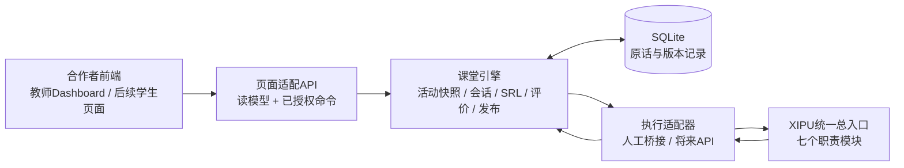

# GroupMate：现有引擎驱动合作者前端的对接设计

日期：2026-10-24。交付性质：源码审阅后的对接方案，不表示已经完成前端改造或线上接通。

## 1. 推荐决策

保留合作者Dashboard的导航、视觉、卡片、表格和证据抽屉，以现有Python/SQLite课堂引擎作为数据与权限的权威来源；增加一层页面数据适配接口，把引擎领域对象转换为前端需要的读模型。XIPU统一工作流作为引擎的模型执行部件，不作为浏览器直接连接的完整后端。

优先把本次提供的Dashboard接成真实的模块三教师端；模块一、模块二暂沿用已跑通的教学工作室和学生页面，再迁移视觉。无需为了接入先重写React，也无需先完成自动API调用。

规则优先级：老师MD教学要求 → 经教师确认的活动快照和权限 → 引擎数据/证据合同 → 前端展示。实现与MD有差距时，同样要改引擎；不能因为已有某个后端字段就曲解前端教学含义。

| 方式 | 代价与适用性 | 决策 |
|---|---|---|
| 前端直接调用XIPU | 只能解决模型回复，仍缺共同会话、版本、归属、审核和统计；会把平台凭证放到浏览器一侧 | 不采用 |
| 现有引擎 + 页面适配层 + 原前端 | 保留现有实现和合作者视觉，新增的工作集中于数据、命令和状态对接 | 推荐 |
| 同时重写前端框架与后端架构 | 改动范围大，对当前课堂演示的收益有限 | 待真实规模需要时再决定 |



学生自评先于反馈可见，但独立Observer不读取自评；教师准备、讨论、报告之间仍保留必要的人工决定。统一入口按阶段调用，不应一次运行后替教师完成全部决定。

## 2. 审阅依据与范围

老师MD与工程基线一致，SHA256：`2db0fcb4e2e3ba20998947f27580c0c697f443296f51e40241d24b1f4797f3f5`。

| 材料 | 本轮实际审阅版本 | 定位 |
|---|---|---|
| GroupMate-AI_Dashboard | `c7a0953cacc6f46fc12761e5ef335583932a6f1c` | 本次指定的主要前端，教师端模块三 |
| GroupMate-AI_UI | `cc92cdfd823a14c5383484a9fd7bae99907b8a02` | 学生/教师交互原型参考，不直接视为最新版要求 |
| GroupMate-AI_Design | `30e94550f3b9d6da4f76f161fe908501cce188c5` | 较早设计展示，包含现版MD已移除的范围 |
| 当前引擎 | 检查点 `8667484` | Python/SQLite状态层、人工桥接、报告与统一入口链接 |

三个前端仓库都是HTML文件内嵌脚本，无`fetch`网络调用。Dashboard的数据来自`window.GM`内的6组合成记录，教师修改来自`localStorage`。本轮也实际读取了线上overview页面，确认展示DEMO DATA和“No student data connected”。

Dashboard的四个页面与MD总体方向相符：Class overview、Group insights、Evidence review、Teaching feedback。已经保留原始记录、四级序位/N/O、教师复核及不计算总分等重要设计，值得沿用。

源码关键位置：Dashboard `index.html:107–219`合成数据；`224–240`本地状态及固定活动信息；`248–255`overview；`257–260`小组详情；`261`证据；`263–267`反馈；`279–280`评价修订；`296`本地确认；`309–310`导出。所有行号对应上述固定提交。

## 3. 三层职责必须分清

### 3.1 前端负责展示与操作

保留导航、筛选、卡片、抽屉、可读性和教师编辑体验。前端选择范围、提交命令、显示服务器返回的状态，不自行判断学生能力、不在浏览器生成班级结论。

前端内的展示状态仍可本地保存，例如Focus view、当前筛选、未提交编辑草稿；教师评价、发布状态、学生自评和课堂原话由服务器保存。

### 3.2 引擎负责教学事实与过程

沿用活动草案和确认、不可变快照、共同会话、时钟与事件、假名ID、原话、提交/确认、自评、独立评价、教师修改及发布。按活动、小组、身份执行读取权限。

统计在引擎代码中计算，文本结论由真实模型建议并经引用检查/教师审核。界面不能从“C3=2”推断“混淆授权”，也不能从讨论热闹推断参与感或知识掌握。

### 3.3 XIPU负责受限的模型任务

保留WF01/02/03/04A/04B/04C/05。后端准备各步骤允许的数据，模型结果经原有校验后进入草案/评价/报告。

当前总入口工作流已发布，但此前获授权且等待平台审批的API范围是角色互动执行器。不能据此宣称总入口全部阶段已经开放API；未来如需总入口API，要单独核实其渠道和授权。本次前端对接可先继续人工桥接。

## 4. 页面—引擎—MD对齐矩阵

| 前端位置 | 可沿用的设计 | 引擎接入/必要改动 | MD依据 |
|---|---|---|---|
| 全局活动条 | 案例、课程、重点维度、版本 | 从snapshot读取，不写死IOM420、15分钟、C2/C3/C4 | 4.5–4.6、10.2 |
| Class overview范围卡 | 已提交/可分析/可用记录分开 | 新增活动场次和明确room_ids范围；各指标分子、分母及缺失原因由后端提供 | 8.3 |
| 首页重点发现 | 一项发现引导到证据 | 替换写死的“2/5组混淆授权”；使用当前报告claim及其真实证据/统计引用，没数据时不造发现 | 5.6、7.3、8.3 |
| Knowledge application | 课程知识与能力评价分开 | 前端4个概念与引擎3个知识标签需要教师确认的concept_id映射；不能仅按数组下标匹配 | 4.5、7.4 |
| 知识分段图 | Supported / Partial / Needs clarification | 先建立真正的小组知识判断；现有partial_count是覆盖缺失，不是Partial application，禁止直接映射 | 7.4、8.2–8.3 |
| Selected competency focus | 个人等级与N/O分开 | 依据本人有效评价，区分未选、待评、数据不完整、缺机会、证据不足；不把null全部解释成同一种N/O | 7.1–7.3 |
| 小组列表 | 不同结论可成立，逐组回查 | 成员数、发言数、时长、报告状态全部动态；组别可分析性不是一个包办所有用途的布尔值 | 5.2、8.2 |
| Original student outcome | 原提交只读 | 显示frozen_submission.raw、版本和成员确认；不能把g.summary或AI摘要塞进原始成果位置 | 8.1 |
| 小组推理变化 | 返回讨论上下文 | 从小组报告和真实事件/发言读取；无动态事件时改为“讨论中的推理发展” | 5.4、9 |
| Individual competency table | 按个人点开解释 | 使用participant_id，支持教师本次所选任意C1–C6；假名只作显示，不能构造主键 | 6.1、7.1–7.3 |
| Evidence review | 原话、作者、上下文、解释 | 从evidence/message记录定位原文和偏移；AI发言可为上下文，但不能成为学生证据 | 7.3 |
| Teacher review | 修改等级、解释或标记证据不足 | 当前后端缺专门的教师评价修订命令，需要新增版本化review；不能只写localStorage | 3、8.1、13 |
| Teaching feedback个人 | 优势/改进/下一步 | 对齐PERSONAL报告及目标、自评对照；优先改进/优势可为null，不强迫填写虚构弱项，教师注释可选 | 8.1、9 |
| Teaching feedback小组 | 保留共同成果与论证 | 使用GROUP报告结构，不把个人等级命名为小组等级 | 8.2 |
| Teaching feedback全班 | 班级层次优先 | 增加六部分报告编辑与引用回查，不能所有层次共用三字段摘要 | 8.3 |
| Confirm locally | 先审后采用 | 改为保存草案/审核发布两个真实命令；服务器返回状态后再显示成功 | 4.1、8.1 |
| 学生反馈门槛 | 先自评后反馈的说明 | 由服务器实际执行本人自评/明确跳过门槛；教师仍可先看小组/班级报告 | 3、8.1、8.3 |
| Export | 可读文本与结构快照 | 从后端导出当前授权、当前版本和范围；正式数据不复用DEMO常量统计 | 8、10.2、13 |
| 旧学生UI | 学习目标、讨论、反思布局 | 移除关键词脚本回复与正则分析，改为消息/模型任务接口；不得由学生按钮提前发布事件 | 6、7.3、9 |
| 旧Design展示 | 可参考设计说明风格 | Career Preparation、固定四KB、必做训练/迁移不作为课堂版接入前置要求 | 2、8.1、10 |

## 5. 必须在设计阶段解决的语义问题

### 5.1 一组数据有多种“可用”含义

不要继续以`group.usable`同时决定原始成果、个人评价和全部知识统计。

分别保留：是否提交；讨论记录完整性；有多少学生记录；各维度能否评价；每个知识点是否覆盖；报告是否已生成、采用及仍有效。一组可以有有效提交而无完整讨论；一个学生可以C3有证据而C4缺机会。

展示用N/O是粗粒度标签，内部原因必须保留。建议读模型至少区分：

| 引擎状态 | 展示 | 是否计算四档分布 |
|---|---|---|
| OBSERVED且有效 | L1–L4，显示本次行为与证据 | 是 |
| INSUFFICIENT_EVIDENCE | N/O · 证据不足 | 否 |
| INSUFFICIENT_OPPORTUNITY | N/O · 缺少适当机会 | 否 |
| DATA_INCOMPLETE | 记录/评价材料不完整 | 否 |
| NOT_SELECTED | 本次未选 | 否 |
| 尚无评价任务结果 | 尚未评价 | 否 |
| STALE / SUPERSEDED | 来源变化/已有新版 | 不混入当前分布 |

当前`class_reports.py`把存在评价但非OBSERVED的选维统入not_observed；首次适配应从维度明细重建原因明细，并修正后端汇总口径。不要只是把前端改得与该粗统计一致。

### 5.2 知识分类与覆盖不能混用

现有引擎`knowledge_supported_groups`表示“至少一名成员存在该标签的SUPPORTED证据的小组数”；同一组还可能存在覆盖缺失。其`partial_count`表示部分成员有该标签记录，并不表示知识只掌握一部分。

第一版可以保留卡片外观，显示“发现支持性证据的小组数 + 覆盖情况”，并清楚说明口径。若要完整保留前端互斥的Supported/Partial/Needs clarification分段图，需要新增`GroupKnowledgeObservation`：group_id、concept_id、status、evidence_ids、submission_refs、explanation、review_state、version。它评价共同讨论/成果，不从个人平均等级推导。

这些组级知识状态可由真实模型提出草案、教师审核采用；每个概念的适用小组分母明确，未评/缺失单列。不能强行将现有个人MISUSE、UNCERTAIN逐项翻译成小组的Needs clarification、Partial。

### 5.3 班级核心发现不能靠等级筛选代替

源码`insight-evidence`固定跳到C3/L2；这不等于进入“授权混淆”的证据集合。改为claim携带明确的group_ids、evidence_ids和stat_ids，由证据页按这些ID筛选。

原型里的“2 of 5”不是可复用事实。若需要自动计算某类误解出现的组数，应先由教师确认问题分类，再记录组级证据判断并由代码计数。第一版可只展示六节班级报告中的一个有证据claim，不附不存在的频次。

### 5.4 教师修改与独立Observer分别保存

当前前端`saveReview()`直接覆盖展示层level/rationale；引擎尚无对应教师评价修订接口。

建议保留三个对象：原始AI独立评价；教师Review版本（指向原评价、本人证据、选维及理由）；当前采用的评价版本。教师可修改采用结论，但不改原话或删除AI原始基线。个人反馈与班级统计按当前采用版本生成，保留来源类型，教师可回看两者分歧。

需要同步调整评价输入合同：反馈使用`adopted_assessment`及来源版本，保留`ai_baseline_reference`；不能把教师改过的值继续冒称为原始AI独立判断。当前PERSONAL合同要求复制`independent_assessment`，这一处要明确升级，而不只是前端叠加一个分数。

老师修订会使依赖旧采用版本的个人反馈和对应班级范围报告过期。后端计算依赖关系；不要沿用原型把所有浏览器反馈一律清空，也不要让旧报告仍显示已发布且有效。

## 6. 前后端接口设计

### 6.1 一个API客户端，两个数据实现

前端拆分为`api-client.js`、`data/engine-adapter.js`、`data/demo-adapter.js`、`views/*.js`。保留现有HTML/CSS和渲染函数，第一轮不要求框架迁移。

`DemoAdapter`保留现有合成样例供设计展示。`EngineAdapter`请求服务器。明确选择模式；真实接口失败时显示未连接/暂无数据，不静默填入6组样例。

`data_mode`（合成/课堂）、`execution_mode`（人工工作流/API）和`review_state`（草案/发布/过期）相互独立。即使已接上引擎，也可能仍是合成课堂和人工执行，不能因此将DEMO改成LIVE。

### 6.2 新增页面读模型（以下是拟新增，不是现有接口）

| 拟新增接口 | 返回内容 | 复用的引擎能力 |
|---|---|---|
| GET /api/v1/teacher/sessions | 教师拥有的课堂场次、固定活动版本、小组范围 | rooms、活动快照；新增场次映射 |
| GET /api/v1/teacher/sessions/{id}/dashboard | 活动条、范围卡、重点发现、知识及选维覆盖、小组列表 | ClassReports、有效report/assessment；新增聚合读模型 |
| GET /api/v1/teacher/groups/{id} | 原始提交、成员确认、AI归纳、知识观察及个人评价表 | room_view、review.dashboard |
| GET /api/v1/teacher/sessions/{id}/evidence | 按组、学生、维度、claim筛选的核验证据 | 原evidence和当前评价版本 |
| GET /api/v1/teacher/evidence/{id}/context | 原话、作者、seq、偏移、前后文、事实版本 | room.events、evidence |
| GET /api/v1/teacher/reports/{id} | 对应PERSONAL/GROUP/CLASS完整body、状态及来源 | 现有反馈/班级报告 |

新增TeachingSession仅表示教师组织的一次课堂场次：owner_id、snapshot_id、room_ids、课程显示名、data_mode。所有范围由服务器验证，不由前端任意拼接其他教师/其他活动小组。可先在适配层维护映射，后续再单独建表。

人数分母必须有来源。现有引擎可确定已加入小组的成员数，不能据此推算全班应到人数。第一版显示“已入组学生”；只有教师另外提供场次名单或预计人数后，才显示“应到/已加入/未加入”。下方合同中的registered_students若无名单来源，应为空并显示对应口径，不能复制样例中的24人。小组总数同样区分已创建与计划小组。

读模型保留版本、unit和计数基数：scope、snapshot_id、rubric_version、selected_dimensions、source_hash、生成时间、missing reasons、strata、模型/教师采用来源。数组中的标签都有稳定ID；成员以participant_id关联，不以可重名假名关联。

可以用如下页面结构作为前后端共同合同（字段为设计结构，并非宣称现有API已经如此返回）：

```text
DashboardReadModel
  schema_version, data_mode, execution_mode
  session{id, title, room_ids, snapshot_id}
  activity{title, course_label, configured_seconds, selected_dimensions, rubric_version}
  scope{registered_groups, submitted_groups, registered_students, records_available,
        groups_with_discussion, assessments_ready, missing_reasons}
  strata[]{id, snapshot_id, difficulty, prompt_intensity, actual_duration, support_conditions}
  highlight{report_id, report_version, claim_id, text, evidence_ids, stat_ids} | null
  knowledge[]{concept_id, label, metric_definition, numerator, denominator,
              coverage, judgement_categories?}
  dimensions[]{dimension, eligible, observed, levels{1,2,3,4}, not_observed_by_reason,
               pending, data_incomplete}
  groups[]{room_id, name, member_count, student_message_count, submission_version,
           submission_status, report_status, source_current}
```

首页操作计数可以跨当前场次统计；能力/知识比较保留条件分层。现有引擎的stratum含实际时长，可能导致较细分组，不能为了凑成前端一个5组图表随意合并。第一版提供分层选择或逐层展示；以后若定义可合并时长区间，由教师确认并记录聚合政策。

### 6.3 命令与现有接口复用

| 前端动作 | 当前可复用接口 | 需要新增/升级 |
|---|---|---|
| 保存活动、确认、发布 | POST /api/update、/api/confirm、/api/publish | 页面适配包装，不重写领域规则 |
| 备课生成建议与采用 | /api/preparation/task、/import、/decide | 后续统一执行任务状态 |
| 加组、发言、提交、确认 | /api/join、/message、/submit、/ack | 学生UI接入；先保留现有字段合同 |
| 控制时钟与事件 | /api/control及引擎tick | 前端只显示权威状态；学生无发布事件权限 |
| 目标/策略/自评/下一步 | /api/goal、/api/learning、/api/reflection | 旧UI不再用前端分析充当评价 |
| 教师修改评价 | 当前缺专门接口 | POST /api/v1/teacher/assessments/{id}/reviews，建立教师Review和采用版本 |
| 保存反馈修订 | POST /api/review/revise | 页面编辑转为对应body；新增版本，不覆盖原文 |
| 审核发布 | POST /api/review/publish | 接口成功后显示已发布；自评可见门槛仍由服务器执行 |
| 小组知识标签审核 | 当前无组级结构化记录 | POST /api/v1/teacher/groups/{id}/knowledge-reviews |
| 导出 | POST /api/archives/export（每组内部记录） | 新增按场次/报告范围的可读导出；原接口不等于全班导出 |

命令提交已有revision或相应source_hash，返回服务器保存的版本和状态。未提交的编辑可暂存在前端，保存成功后再标为已保存。当前已有draft.revision和submission.expected_version可沿用。

## 7. 模型执行与页面状态

引擎增加统一`WorkflowExecutor`接口，前端只发起某个教学任务；手动和API执行共用同一套输入准备、输出校验与领域保存逻辑。

人工模式：创建任务→等待教师运行XIPU→粘贴/文件导入→原合同核验→待审/按已确认规则发布。将来API模式：创建任务→后台执行→核验→相同后续流程。

建议任务状态：NOT_REQUESTED、QUEUED、RUNNING、WAITING_MANUAL_RESULT、VALIDATING、READY_FOR_REVIEW、PUBLISHED、FAILED、STALE。采用稳定task_id关联来源，不由前端把模型文字直接当成成功结果。

第一版轮询任务和课堂状态即可；无需为此先引入WebSocket。当前引擎自动API传输只连接角色执行器，不能将其他步骤画成已经可自动运行；审批后逐步把执行适配器接入现有统一总入口。

## 8. 部署方式

本机演示优先同源：将适配后的Dashboard作为引擎静态页面，例如`/teacher/#overview`，API仍为同域`/api/...`。现有服务器有静态文件白名单和CSP，需要添加实际页面/脚本路径；不要以嵌入原页面iframe代替数据接入。

当前GitHub Pages页面保留为视觉/合成演示。它与127.0.0.1不属于同一来源，现有引擎还会拒绝不同Origin的请求；学生设备中的127.0.0.1也只指向学生自己的电脑。因此不能只把fetch地址写为localhost就当作已经完成全班接通。

真实课堂阶段再部署一个学校允许访问的HTTPS应用域名，通过同源反向代理提供前端和API，并替换本机共享教师口令为明确的教师身份/权限。密钥只放服务器，前端无需了解XIPU密钥或平台内部提示词。

## 9. 分阶段实施与分工

| 阶段 | 引擎侧工作 | 前端侧工作 | 跑通标准 |
|---|---|---|---|
| P1：真实只读Dashboard | 场次范围、页面DTO、计数口径/缺失原因 | 分离DemoAdapter/EngineAdapter；替换硬编码和window.GM | 一个实际合成小组的提交、原话、评价、已发布报告能在新Dashboard回查；无固定6/5/20数字 |
| P2：教师真实操作 | 评价Review/采用版本、报告修订发布、依赖失效 | 抽屉保存调用后端；三类反馈编辑；显示待审/发布/过期 | 教师改一条解释并保存/发布，刷新后仍在；原话不变，依赖旧版本的报告正确待更新 |
| P3：完整视觉统一 | 保留既有备课与学生API，补必要适配 | 迁移模块一/二视觉，保留九项决定与学生共同会话/SRL | 教师准备→两名学生讨论→自评→反馈与班级汇总在统一视觉下完成 |
| P4：自动模型传输 | 核实授权渠道，执行器接API与任务状态 | 将人工等待状态换成真实运行状态 | 一次实际任务从前端发起、模型返回、后端核验到显示，无手动复制 |

先完成P1、P2即可让本次指定的Dashboard由引擎驱动。P3是整个产品前端统一，不应阻塞模块三接入。P4的审批不应阻塞P1/P2。

建议合作者负责组件、视觉、页面状态和接口消费；引擎侧负责DTO、审核命令、统计语义、角色权限与执行适配。共同先确认数据合同、知识分类和教师评价采用规则，再分别修改代码。

## 10. 与MD的取舍准则

- 保留课堂Teaching Copilot定位；旧Design里的求职群面入口不恢复为本版主流程。
- 不强制固定四个知识库、固定四名角色、固定IOM420案例；四种来源、角色和选维按活动配置。
- 短练习和迁移挑战作为可选扩展，不应成为查看课堂反馈的强制门槛。
- 不把C1–C6序位等级做总分、均值或排名；不以“未观察到”自动诊断弱项。
- 教师班级报告保留六部分，个人反馈保持简洁可展开；小组结论与个人能力分开。
- 前端和引擎都遵守来源、教师确认、活动快照、本人证据及自评可见规则。

## 11. 本轮交付和后续验证边界

本轮只做公开源码/页面和现有引擎审阅，形成上述设计；未修改合作者仓库、推送代码或部署真实前端。三个仓库的只读审阅副本保存在本工作区`work/frontend-integration-20261024/source`。

实施时遵循用户已有要求，只保留正常功能主路径检查：读模型显示一个实际场次、教师保存/发布一份报告、学生自评后看到本人反馈。不要为了对接再扩张无穷边界测试；真实多设备课堂和教学效度仍单独说明。

### 源码与设计依据

- [Dashboard固定版本](https://github.com/Sivan-Bu/GroupMate-AI_Dashboard/blob/c7a0953cacc6f46fc12761e5ef335583932a6f1c/index.html)
- [学生UI参考固定版本](https://github.com/Sivan-Bu/GroupMate-AI_UI/blob/cc92cdfd823a14c5383484a9fd7bae99907b8a02/index.html)
- [旧Design参考固定版本](https://github.com/Sivan-Bu/GroupMate-AI_Design/blob/30e94550f3b9d6da4f76f161fe908501cce188c5/index.html)
- 当前仓库：`groupmate/server.py`、`domain.py`、`review.py`、`feedback.py`、`class_reports.py`、`manual_roles.py`、`preparation.py`。
- 老师MD：模块一4.1–4.6，共同会话6，六维7，成果8，SRL9，职责与权限10，数据责任13。
